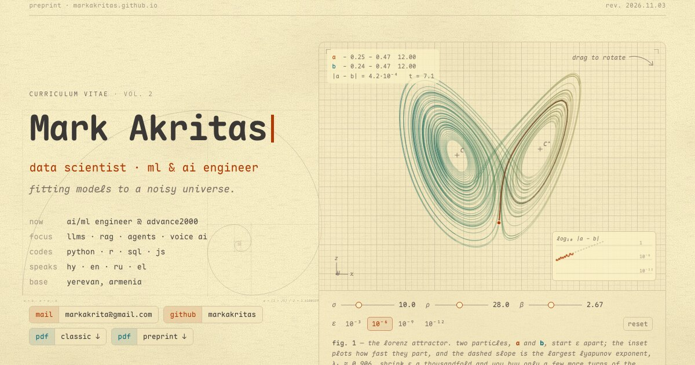

# markakritas.github.io



Mark Akritas's resume, typeset like a preprint and drawn with live figures: a Lorenz attractor you can rotate, a career scored as a piano roll, the stack charted as a star atlas, languages recorded as signals, and Ararat redrawn by Fourier circles. It uses the gruvbox palettes and Maple Mono of the [profile README](https://github.com/markakritas/markakritas). Light by default; `:set bg=dark` in the top bar (or `t`) switches. No frameworks and no build step.

```text
index.html            the page: structure and prose
404.html              not significant
data/
  cv.json             roles, skills, skill families, languages, projects
  extras.json         the philosophy map, quotes and equations of the day
assets/
  css/style.css       the paper, the plates, the layout, both themes
  js/cv.js            loads data/*.json, checks it, derives what the figures need
  js/lib.js           shared helpers: palette, render loop, lorenz / dft / marching-squares maths
  js/site.js          every interactive figure on index.html
  fonts/              Maple Mono, JetBrains Mono (maths), UnifrakturMaguntia, Noto Serif Armenian; subset, SIL OFL
  img/                favicon, social preview
resume/
  mark-akritas-resume.pdf            the classic, professional resume
  mark-akritas-resume-preprint.pdf   the preprint edition
  print.html                         its source
v1/                   the first edition, 2018
```

## adding to it

Everything the figures draw comes from `data/cv.json`; the piano roll, the star atlas, both job lists and the preprint PDF are rebuilt from it on load. To add a role, add an object to `career` (roles show in file order within their group):

```json
{
  "id": "acme", "group": "industry", "role": "Senior ML Engineer", "where": "Acme",
  "org": "What Acme does", "start": "2027-03", "end": null, "main": true,
  "text": "One or two sentences on the work.",
  "skills": ["python", "llm", "rag", "docker"]
}
```

- `start` / `end` are `"YYYY-MM"`; `end: null` means ongoing. `main: true` lists the role under work experience with its text; without it the role goes under other experience.
- `skills` are ids from the `skills` list. They draw the role's chord in fig. 2 and set each star's brightness in fig. 3; a skill's first light is the start of the earliest role that lists it.
- A new skill is one line in `skills`: `{ "id": "jax", "name": "JAX", "family": "model" }`, optionally with `abbr` (its label on the atlas), `level` (basic · intermediate · good · excellent, shown under programming) or `since` (a first-light year, for tools younger than the roles that used them).
- `groups` and `families` map names to gruvbox colour tokens and set their order.

Typos are reported in the browser console as `[data] …` warnings, such as a role listing a skill id that doesn't exist. The JSON is fetched, so preview through a server (`python3 -m http.server`), not by opening the file directly. Prose such as the abstract and the captions lives in `index.html` and `resume/print.html`, and the education cards with their sketches are in `index.html`.

## rebuilding the preprint PDF

Serve the folder, open `http://localhost:8000/resume/print.html` in Chrome, and print to PDF with paper A4, margins none and background graphics on. Or headless, from the repo root:

```sh
python3 -m http.server 8000 &
"/Applications/Google Chrome.app/Contents/MacOS/Google Chrome" --headless=new --no-pdf-header-footer \
  --virtual-time-budget=4000 --print-to-pdf=resume/mark-akritas-resume-preprint.pdf http://localhost:8000/resume/print.html
```
